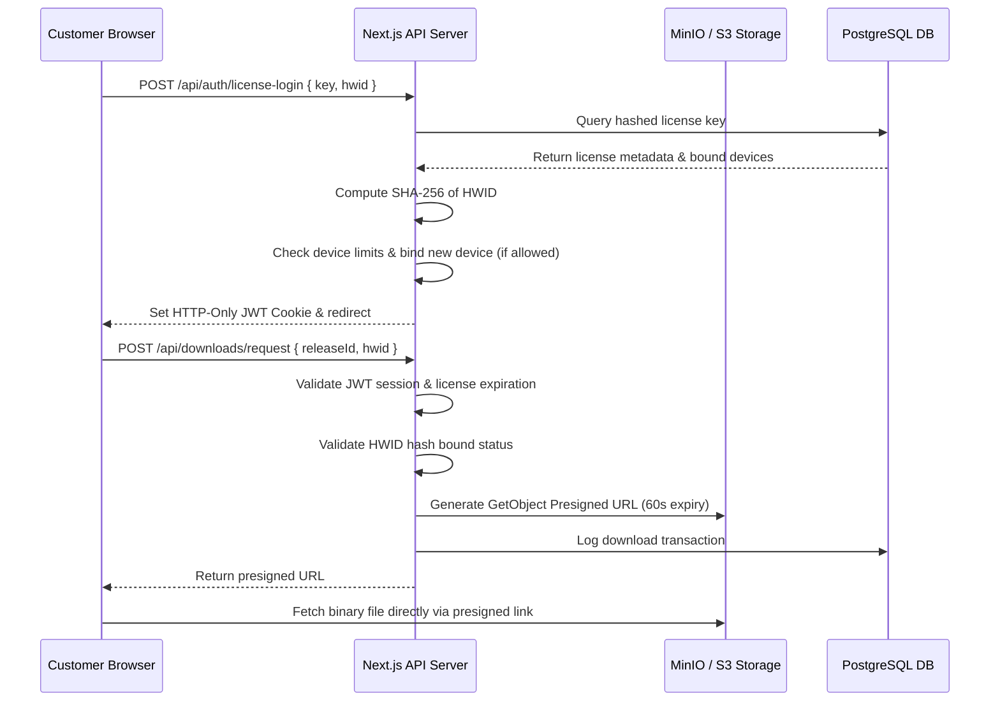

# Secure Software License Portal

A full-stack licensing system designed to protect Windows executables, automate purchases via Stripe, enforce machine binding (HWID), and securely deliver files on-demand using private object storage.

---

## 🏗️ Architecture & Security Model



### 1. Cryptographic Key Protection
- **Hashed Keys**: License keys are hashed using SHA-256 before storing in the database.
- **Leak Prevention**: Even if the database is fully compromised, attackers cannot retrieve or bypass active license keys. The raw key is only shown to the user once upon creation.

### 2. Device/Hardware Binding (HWID)
- **Zero Raw Data Stored**: The client application transmits a unique HWID checksum. The server hashes it again before storage.
- **Binding Limits**: Each key defines a maximum number of unique devices (`maxDevices`). Login or download attempts from unregistered devices are rejected once this threshold is reached.
- **Reset Controls**: Admins can clear bound devices through the Admin dashboard.

### 3. Secure File Delivery
- **No Public Files**: Binary files (`.exe`) are stored in private S3/MinIO buckets.
- **Short-Lived URLs**: Downloads are routed through a server-side endpoint that generates a 60-second presigned URL, preventing URL sharing and leakage.

---

## 🚀 Step-by-Step Setup Guide

### 1. Prerequisites
- Docker & Docker Compose
- Node.js v20+

### 2. Environment Configuration
Copy `.env.example` to `.env` and configure your settings:
```bash
cp .env.example .env
```

### 3. Start Local Services
Spin up PostgreSQL, Redis, and MinIO storage in the background:
```bash
docker-compose up -d
```

### 4. Database Setup
Run Prisma migrations to construct the database schema and generate the Prisma client:
```bash
npx prisma db push
```

### 5. Create Initial Admin Account
Run this quick database script to insert an admin user:
```bash
npx prisma db seed
```
*(Make sure to set the password hash using the `lib/crypto` utility).*

### 6. Start the Next.js Dev Server
```bash
npm run dev
```
Open [http://localhost:3000](http://localhost:3000) to view the portal.

---

## 🛠️ Tech Stack
- **Framework**: Next.js App Router (TypeScript)
- **Database**: PostgreSQL (Prisma ORM)
- **Caching & Rate Limiting**: Redis
- **Storage**: MinIO / AWS S3
- **Styling**: Tailwind CSS v4 (Design tokens in `globals.css`)
- **Payments**: Stripe
